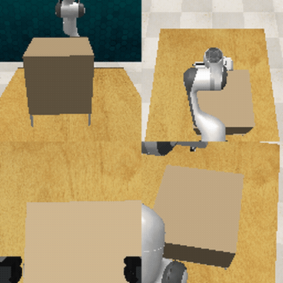

# ROEPBench

Deployment-oriented evaluation protocol for robotic manipulation tasks under systematic observation perturbations.



## Overview

ROEPBench runs RLBench-style manipulation episodes, applies vision/depth/occlusion perturbations, and logs success, trajectory length, recovery behavior, and safety-related metrics. It is designed for reproducible comparison of baseline and recovery-aware policies.

## Repository layout

```text
roepbench/            # Python package (add to PYTHONPATH)
  roepbench/          # core: runners, perturbations, recovery, risk suite, model plugins
  tests/              # pytest suite
scripts/              # evaluation / analysis entry points
  libero/             # LIBERO track helpers (canaries, env checks, gates)
configs/              # experiment preset YAMLs (paths are repo-root-relative, `./...`)
envs/                 # conda environment specs
```

## Requirements

- External simulators/models are **not** vendored here: RLBench (+PyRep), LIBERO,
  and model checkpoints/weights must be installed separately.
- See `envs/` for conda environment specs
  (`roep_libero_core`, `roep_openvla_libero`, `roep_smolvla_libero`).
- Checkpoints, datasets, and run outputs are excluded from version control
  (see `.gitignore`).

## Setup (LIBERO track)

```bash
bash scripts/libero/create_conda_envs.sh
# clone official LIBERO (+ OpenVLA/SmolVLA repos if needed) into external/,
# then inside each conda env:
bash scripts/libero/post_install_libero_core.sh
```

Verify an environment before running evaluations:

```bash
conda activate roep_libero_core
python scripts/libero/check_libero_core.py
```

## Tracks

| Track | Entry point | Description |
|---|---|---|
| RLBench smoke | `python -m roepbench.run_eval ...` | single-task evaluation (see Quick Start) |
| RLBench matrix | `python scripts/run_roep_experiments.py` | reproducible multi-condition command generation |
| LIBERO canary | `bash scripts/libero/run_phase1_core_canary.sh` | core smoke gate |
| LIBERO minimal gate | `bash scripts/libero/run_minimal_gate.sh` | clean baseline + admission |
| LIBERO full pipeline | `bash scripts/run_external_libero_pipeline.sh` | orchestration (canaries, admission, assessment) |
| Model smoke | `bash scripts/libero/run_<model>_canary.sh` | per-model smoke (`openvla`, `smolvla`, `xvla`, `pi0fast`) |

Validators/reporters: `validate_roep_runs.py`, `assess_libero_perturbation.py`,
`assess_model_admission.py`, `evaluate_phase_gates.py`, `aggregate_roep_metrics.py`,
`generate_libero_research_report.py`.

## Quick Start

```bash
PYTHONPATH=./roepbench python -m roepbench.run_eval \
  --task open_drawer \
  --episodes 1 \
  --out_dir runs/smoke_001 \
  --use_xvfb
```

Outputs:

- `runs/smoke_001/episode_logs.jsonl`
- `runs/smoke_001/summary.csv`

## Environment overrides

Machine-specific defaults (interpreter paths, dataset roots) resolve under
`$HOME` and can be overridden without editing code:

| Variable | Purpose |
|---|---|
| `PROJECT_ROOT` / `ROEP_PROJECT_ROOT` | repo root (shell scripts auto-detect it) |
| `ROEP_LIBERO_ROOT` | LIBERO checkout location |
| `ROEP_EVAL_PYTHON`, `ROEP_PRM_PYTHON`, `ROEP_OPENVLA_PYTHON`, `ROEP_XVLA_PYTHON`, `ROEP_SMOLVLA_PYTHON`, `ROEP_PI0FAST_PYTHON`, `ROEP_CORE_PYTHON`, `ROEP_VLA_ADAPTER_PYTHON` | per-model conda interpreters |
| `ROEP_EXTERNAL_<MODEL>_CMD` / `ROEP_EXTERNAL_<MODEL>_<STAGE>_CMD` | external model eval commands |

Config YAMLs use repo-root-relative paths (`./results/...`, `./checkpoints/...`);
run them with the repository root as the working directory.

## Tests

```bash
cd roepbench && python -m pytest tests/ -q
```

## License

MIT — see [LICENSE](LICENSE).
